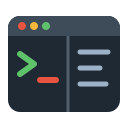

<div align="center">



<h1>TTM v2 (Tmux Terminal Manager)</h1>

<p><strong>Tmux for people who don&#39;t do Tmux, integrated into <a href="https://unraid.net/">Unraid</a>.</strong></p>

<p>
  <a href="https://github.com/andrebrait/TTM-unRAID/releases"></a>
  
  <a href="LICENSE"></a>
</p>

</div>

## Fork notice

TTM v2 is a maintained fork of [desertwitch/TTM-unRAID](https://github.com/desertwitch/TTM-unRAID) by desertwitch, who wrote the plugin (original [forum thread](https://forums.unraid.net/topic/183427-plugin-tmux-terminal-manager-ttm/)). Upstream has announced its end of support, so this fork carries on maintaining the plugin and publishes its own releases.

The plugin is named `ttm2` (previously `dwttm`) so it does not clash with the original in Community Applications.

### Installation

In the Unraid web UI, go to **Plugins → Install Plugin** and enter:

```
https://raw.githubusercontent.com/andrebrait/TTM-unRAID/main/plugin/ttm2.plg
```

Installing it replaces the original TTM plugin (or an earlier release of this fork) and keeps your settings.

### Requirements

- Unraid 7.3.4 or later.

### Issues

Report bugs and feature requests in the [issue tracker of this fork](https://github.com/andrebrait/TTM-unRAID/issues).
